<p align="center">
  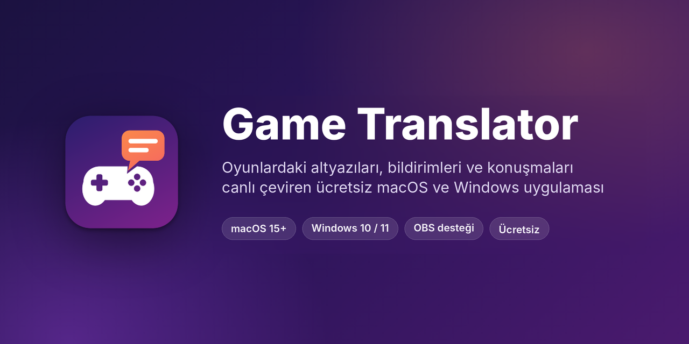
</p>

<p align="center">
  <a href="https://github.com/0xxnr/GameTranslator/releases/latest"></a>
  <a href="https://github.com/0xxnr/GameTranslator/releases"></a>
  
  
  
</p>

<p align="center">
  <a href="https://github.com/0xxnr/GameTranslator/releases/latest"></a>
  &nbsp;
  <a href="https://github.com/0xxnr/GameTranslator/releases/latest"></a>
  <br>
  <sub>Sürüm sayfasında Mac için <code>…-macOS.zip</code>, Windows için <code>…-Windows.zip</code> dosyasını indir.</sub>
</p>

<p align="center">
  <a href="#konsol-oyunlari">Konsol oyunları</a>
  &nbsp;·&nbsp; <a href="#dil-paketleri"><b>İnternetsiz çeviri</b></a>
  &nbsp;·&nbsp; <a href="#oyun-rehberi">Oyun rehberi</a>
  &nbsp;·&nbsp; <a href="#kurulum">Kurulum</a>
  &nbsp;·&nbsp; <a href="#özellikler">Özellikler</a>
  &nbsp;·&nbsp; <a href="#obs-ile-yayın"><b>OBS ile yayın</b></a>
  &nbsp;·&nbsp; <a href="#sık-sorulanlar">Sık sorulanlar</a>
  &nbsp;·&nbsp; <a href="CHANGELOG.md">Sürüm notları</a>
</p>

---

<h2 align="center">Konsoldaki oyunlar artık Türkçe</h2>

<p align="center">
  <b>PlayStation, Xbox ve Nintendo Switch oyunlarını Mac'inde ya da Windows PC'nde anlık çevir.</b><br>
  İster <b>yapay zekâ</b> ile, ister <b>Apple'ın ücretsiz ve çevrimdışı çevirisiyle</b> (macOS).<br>
  Türkçe desteği olmayan oyunlar, altyazısız diyaloglar, haritalar ve görev metinleri — hepsi oynarken, anında Türkçe.
</p>

**Game Translator**, oyun ekranındaki yazıyı okur, çevirir ve çeviriyi **orijinal yazının tam üstüne** çizer. Altyazı değiştikçe
ve pencere taşındıkça takip eder. Altyazısı olmayan diyalogları dinleyip çevirebilir, çevirileri **OBS** ile yayına da gönderebilir.
PS Remote Play, Elgato, GeForce NOW, Steam Link, tarayıcı ve video oynatıcılarla çalışır.

> **macOS** (Apple silicon) ve **Windows 10 / 11** sürümleri var; ikisi de ücretsiz ve aynı özellikleri sunar.
> Windows'taki küçük farklar için [Windows'ta kurulum](#windowsta-kurulum) bölümüne bak.

### Oyunda nasıl görünüyor?

<p align="center">
  <a href="https://github.com/0xxnr/GameTranslator/blob/main/assets/tanitim.mp4">
    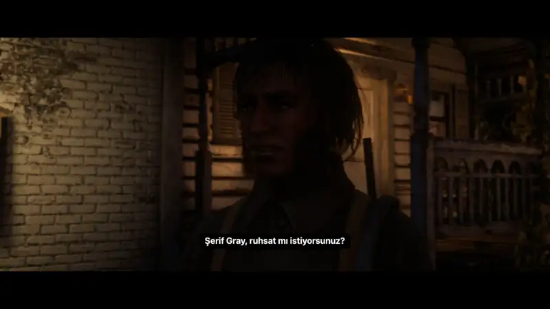
  </a>
  <br>
  <sub>İngilizce diyaloglar oynarken Türkçe çeviri, orijinal altyazının üstünde anında beliriyor.
  <a href="https://github.com/0xxnr/GameTranslator/blob/main/assets/tanitim.mp4"><b>Sesli videoyu izle</b></a></sub>
</p>

<p align="center">
  <a href="https://github.com/0xxnr/GameTranslator/blob/main/assets/tanitim-2.mp4">
    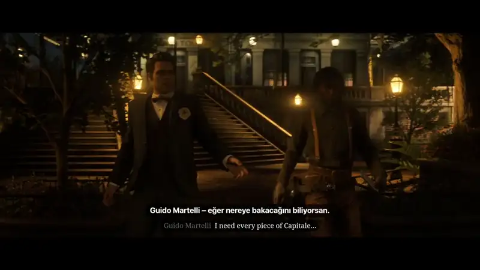
  </a>
  <br>
  <sub>Uzun bir diyalog sahnesi: karakter adıyla birlikte her replik anında Türkçe.
  <a href="https://github.com/0xxnr/GameTranslator/blob/main/assets/tanitim-2.mp4"><b>Sesli videoyu izle (1 dk)</b></a></sub>
</p>

### Altyazı dışındaki yazılar da çevrilir

Harita açıklamaları, görev ve ipucu panelleri, bildirimler… Oyun profiline eklediğin her bölge ayrı okunur ve ayrı çevrilir.

<p align="center">
  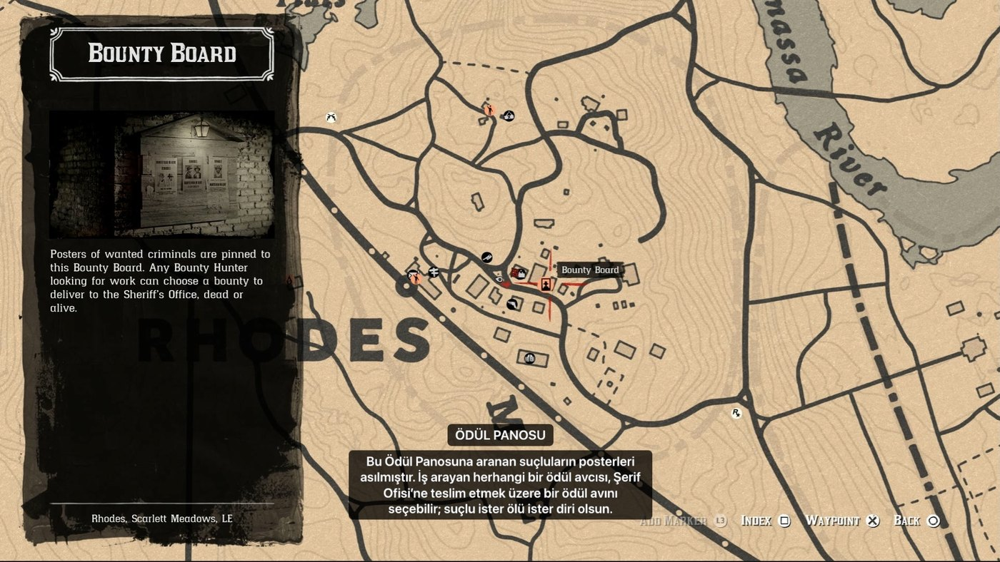
  <br>
  <sub>Haritadaki İngilizce bilgi paneli okunuyor, Türkçe çevirisi başlığıyla birlikte ekranda beliriyor.</sub>
</p>

<p align="center">
  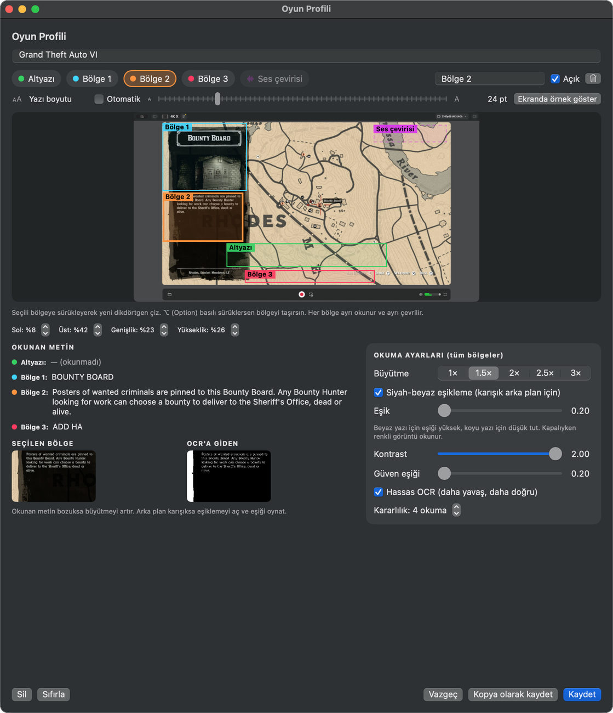
  <br>
  <sub>Aynı sahnenin profil ayarı: <b>Bölge 1</b> başlığı, <b>Bölge 2</b> açıklama metnini okuyor. Karışık zeminde <b>siyah-beyaz eşikleme</b> ve <b>kontrast</b> okumayı netleştiriyor.</sub>
</p>

<p align="center">
  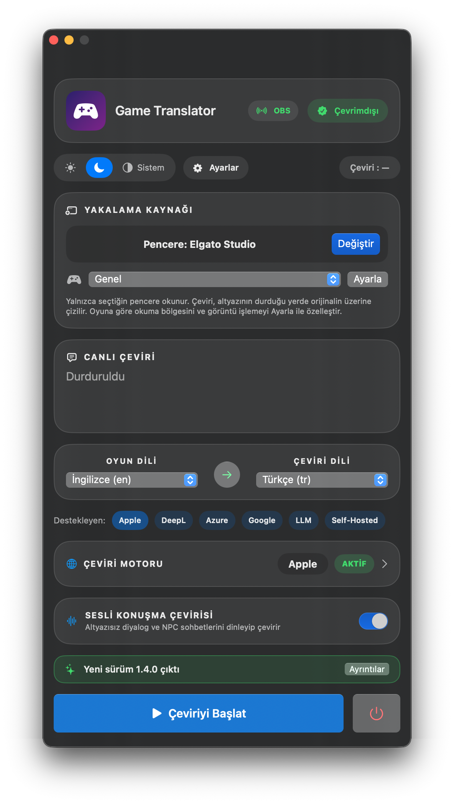
  &nbsp;&nbsp;
  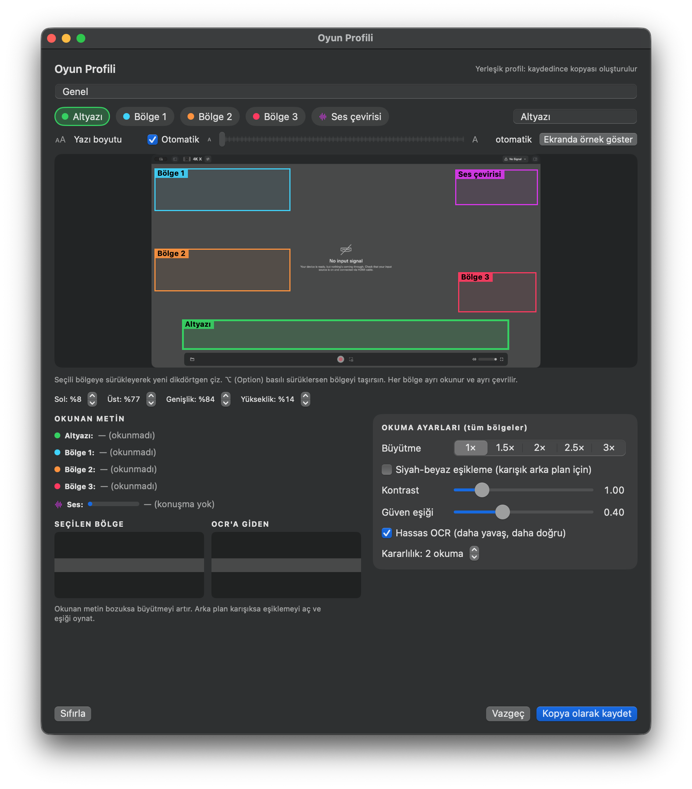
</p>

<a id="konsol-oyunlari"></a>

## Konsol oyunlarını anlık çevir

Türkçe dil seçeneği olmayan bir oyunu artık beklemeden oynayabilirsin. Konsolun görüntüsünü Mac'e getirmen yeterli;
Game Translator ekrandaki İngilizce (ya da başka dildeki) yazıyı okur ve **Türkçesini orijinalin tam üstüne** yazar.
Oyuna, konsola ya da hesabına hiçbir şey kurulmaz, hiçbir şey değiştirilmez: yalnızca ekranda görünen okunur.

| Konsol | Bilgisayarıma nasıl gelir? |
|---|---|
| **PlayStation 5 / 4** | **PS Remote Play** uygulaması ya da **Elgato** gibi bir yakalama kartı |
| **Xbox Series / One** | Tarayıcıda **xbox.com/play** üzerinden uzaktan oynatma ya da bulut oyun, veya yakalama kartı |
| **Nintendo Switch** | Yakalama kartı (Elgato vb.) |
| **Bulut oyun** | **GeForce NOW**, Xbox Cloud Gaming ve benzerleri (uygulama ya da tarayıcı) |
| **PC / Mac oyunları** | **Steam Link**, Moonlight ya da doğrudan oyun penceresi |

Kaynağı **Değiştir** ile seç, oyun profilini ayarla, **⌃⌥T** ile çeviriyi başlat. Çeviri oyun penceresini takip eder;
oynarken başka hiçbir şeye dokunman gerekmez.

<a id="dil-paketleri"></a>

## İnternetsiz çeviri: oyun dil paketleri

Dil paketi, bir oyunun **"orijinal metin → Türkçe çeviri"** listesidir. Paketi oyun profiline bağladığında o oyunda ekrandan okunan yazı
önce pakette aranır; bulunursa paketteki çeviri gösterilir, hiçbir yere bağlanılmaz. Bulunamayan yazılar seçtiğin çeviri motoruna kalır.

- **Çevrimdışı oynayanlar için:** uçakta, yolda, internetin zayıf olduğu yerde ya da bulut motorun sınırı dolduğunda çeviri sürer.
- **Doğru terimler:** topluluk Türkçe yamalarındaki ya da kendi düzelttiğin çeviriler kullanılır; eşya, yetenek ve görev adları hep aynı çıkar.
- **Sıfır gecikme:** paketten gelen çeviri motoru beklemez, altyazı belirdiği anda ekrandadır.

> Dil paketleri macOS sürümünde, **1.5.0** ile geldi.

### Kendi paketini elle hazırla
1. En kolayı CSV: 1. sütun orijinal, 2. sütun çeviri. Excel, Numbers ya da Google E-Tablolar'da hazırlayıp CSV olarak kaydet.
   Hazır şablon: [ornek-dil-paketi.csv](dil-paketleri/ornek-dil-paketi.csv).
2. **Ayarlar › Dil paketleri › Dil paketi ekle…**
3. **Oyun Profili › Ayarla › Dil paketi**'nden seç.

| Biçim | Örnek |
|---|---|
| **CSV / TSV** | `"Bounty Board","Ödül Panosu"` |
| **TXT** | `Bounty Board = Ödül Panosu` |
| **JSON** | `{"name": "Oyun adı", "entries": {"Bounty Board": "Ödül Panosu"}}` |
| **PO** (gettext) | `msgid "Bounty Board"` / `msgstr "Ödül Panosu"` |

**Akıllı eşleşme:** ekrandan okunan yazıdaki küçük harf hataları, eksik noktalama ve baştaki konuşmacı adı tolere edilir. Emin olunamayan
eşleşmeler kullanılmaz, çeviri motoruna bırakılır; yanlış çeviri gösterilmez.

<a id="oyun-rehberi"></a>

## Oyun rehberi: Türkçesi olmayan güncel PS5 oyunları

Hepsi Game Translator ile **çeviri motoruyla** (Apple ya da yapay zekâ) anında çevrilebilir. Oyunun PC sürümü varsa,
dil dosyalarından **dil paketi** oluşturup çeviriyi oyunun kendi metinleriyle ve internetsiz yapabilirsin.

| Oyun | Motor | Dil dosyası | Game Translator'da |
|---|---|---|---|
| **Marvel's Wolverine** | Insomniac (PS5'e özel) | PC sürümü yok, dosya çıkarılamaz | Çeviri motoru; topluluğun elle hazırladığı CSV paketi |
| **Saros** | Housemarque (PS5'e özel) | PC sürümü yok | Çeviri motoru; elle hazırlanmış CSV paketi |
| **Resident Evil Requiem** | Capcom RE Engine | `.msg` (oyunun `.pak` arşivlerinde) | Tablodan: `.msg` → CSV dışa aktarımı |
| **Onimusha: Way of the Sword** | Capcom RE Engine | `.msg` | Tablodan: `.msg` → CSV dışa aktarımı |
| **Monster Hunter Wilds** | Capcom RE Engine | `.msg` | Tablodan: `.msg` → CSV dışa aktarımı |
| **Red Dead Redemption 2** | Rockstar RAGE | `.gxt2` (`.rpf` arşivlerinde) | İki dil dosyasından: İngilizce + Türkçe `.gxt2` |
| **Grand Theft Auto V** | Rockstar RAGE | `.gxt2` (`.rpf` arşivlerinde) | İki dil dosyasından: İngilizce + Türkçe `.gxt2` |
| **Silent Hill f** | Unreal Engine 5 | `.locres` (`.pak` / `.utoc` içinde) | İki dil dosyasından: İngilizce + Türkçe `.locres` |
| **Hogwarts Legacy** | Unreal Engine 4 | `.locres` | İki dil dosyasından: İngilizce + Türkçe `.locres` |
| **Mafia: The Old Country** | Unreal Engine 5 | `.locres` | İki dil dosyasından: İngilizce + Türkçe `.locres` |
| **Elden Ring Nightreign** | FromSoftware | `.fmg` (`msg/*.msgbnd.dcx` içinde) | İki dil dosyasından: XML'e aktarılmış `.fmg` |
| **Nioh 3** | Koei Tecmo | Kapalı biçim | Çeviri motoru; elle hazırlanmış CSV paketi |

### Dil paketi nasıl oluşturulur?
Konsol oyunlarının dosyaları PS5'in içinde ve şifrelidir; Mac'ten erişilemez. Paket, aynı oyunun **PC sürümündeki** dil
dosyalarından yapılır: oyunun **orijinal (İngilizce) dosyası** ile **Türkçe dosyası** (ör. topluluğun Türkçe yaması) aynı
anahtarlarla eşleştirilir. İki dosya da oyunun **aynı sürümüne** ait olmalı.

1. **Dosyaları çıkar.** Oyunların arşivleri topluluk araçlarıyla açılır:
   - **Unreal Engine** (`.pak` / `.utoc`): FModel ile `Localization/Game/en/Game.locres` ve Türkçe karşılığı dışa aktarılır.
   - **Rockstar RAGE** (`.rpf`): GTA V için OpenIV ya da CodeWalker, RDR2 için CodeX ile `.gxt2` dosyaları çıkarılır.
     Türkçe yamalar genelde `.gxt2` dosyalarını hazır verir.
   - **Capcom RE Engine** (`.pak` → `.msg`): RE Engine paket araçlarıyla `.msg` dosyaları çıkarılır, REMSG_Converter gibi bir
     araçla dillerin ayrı sütunlarda olduğu **CSV**'ye aktarılır.
   - **FromSoftware** (`.msgbnd.dcx` → `.fmg`): WitchyBND ya da Smithbox ile `.fmg` dosyaları **XML**'e aktarılır.
2. **Game Translator'da:** Ayarlar › Dil paketleri › **Oyun dosyalarından oluştur…** (ya da Oyun Profili › Ayarla › Dil paketi › **Oluştur…**)
   - **Oyun dil dosyalarından:** orijinal dosyaları ve Türkçe dosyaları seç. Birden çok dosya seçilebilir (ör. GTA V'nin görev dosyaları).
   - **Çok dilli tablodan:** CSV / JSON tabloyu seç; İngilizce ve Türkçe sütunlar kendiliğinden bulunur, gerekirse değiştir.
   - **Önizle** ile eşleşen çeviri sayısını ve örnekleri gör, **Paketi oluştur**.
3. Paketi oyunun profiline bağla. Oyundaki renk kodları, düğme simgeleri (`~INPUT_CONTEXT~`), etiketler (`<COLOR>`) ve yer
   tutucular (`{0}`) temizlenir; ekrandan okunan yazıyla eşleşme bozulmaz.

| Biçim | Oyunlar |
|---|---|
| Unreal Engine `.locres` (tüm sürümler) | Unreal Engine 4 / 5 oyunları |
| Rockstar `.gxt2` | GTA V, Red Dead Redemption 2 |
| Bethesda `.strings` / `.dlstrings` / `.ilstrings` | Skyrim, Fallout 4, Starfield |
| XML (`id` öznitelikli) | FromSoftware `.fmg` dışa aktarımları ve benzerleri |
| JSON, CSV / TSV, `.po` | Unity, Godot ve dışa aktarılmış yerelleştirme tabloları |

> Oyun metinleri yayıncılarına, Türkçe yamalar hazırlayanlarına aittir. Paketleri kişisel kullanım için oluştur; paylaşmadan
> önce yamanın sahibinden izin al. Game Translator oyun dosyalarını değiştirmez, yalnızca okur.

## Çeviri motoru seçimi: yapay zekâ ya da ücretsiz Apple çevirisi

| | **Apple çevirisi** | **Yapay zekâ (LLM)** | **DeepL · Google · Azure** |
|---|---|---|---|
| **Ücret** | Tamamen ücretsiz | Kendi API anahtarınla; yerel modellerle (Ollama, LM Studio) ücretsiz | Kendi API anahtarınla (ücretsiz kotaları var) |
| **İnternet** | Gerekmez, **çevrimdışı** çalışır | Bulut modelde gerekir; yerel modelde gerekmez | Gerekir |
| **Gizlilik** | Her şey Mac'inde kalır | Yerel modelde Mac'inde kalır | Yalnızca okunan metin sağlayıcıya gider |
| **En iyi olduğu yer** | Hızlı, sıfır kurulumla günlük kullanım | Konuşma dili, argo, deyimler ve bağlamı daha doğal aktarma | Profesyonel, tutarlı çeviri kalitesi |

- **Apple çevirisi** varsayılandır: dil paketi bir kez iner, sonra internet olmadan, ücretsiz ve sınırsız çalışır.
- **Yapay zekâ** seçeneği OpenAI uyumlu her uç noktayla çalışır: OpenAI, **Ollama**, **LM Studio** ve benzerleri.
  Ollama ya da LM Studio ile modeli kendi Mac'inde çalıştırırsan çeviri hem ücretsiz hem de tamamen çevrimdışı olur.
- Motoru **Ayarlar › Çeviri motoru**'ndan istediğin an değiştirebilirsin; ana penceredeki rozet hangisinin aktif olduğunu gösterir.

## Özellikler

| | |
|---|---|
| **Yerinde çeviri** | Çeviri, orijinal altyazının üstünde aynı yerde görünür; tıklamalar oyuna geçer. Ana pencerede orijinal ve çeviri yan yana, çeviri süresi (ms) üstte görünür. |
| **Oyun profilleri** | Altyazı + en fazla 3 ek bölge (bildirim, görev, ipucu) + ses çevirisi alanı. Her bölgenin yazı boyutu ayrı ya da otomatik. |
| **Okuma ayarları** | Büyütme (1×–3×), siyah-beyaz eşikleme, kontrast, güven eşiği, hassas OCR ve kararlılık. "OCR'a giden" görüntüyü canlı izlersin. |
| **Sesli konuşma çevirisi** | Altyazısız diyalogları ve NPC sohbetlerini dinler, mor bir balonda çevirir. Konuşma tanıma cihazda çalışır. |
| **[Dil paketleri](#dil-paketleri)** | Oyunun "orijinal → Türkçe" metinleriyle **internetsiz** çeviri. Oyun dosyalarından (.locres, .gxt2, .strings, .yml, XML) ya da tablodan otomatik oluşturulur; CSV, TXT, JSON, PO ile elle de hazırlanır. |
| **Yazı tipi** | Hazır yazı tipleri, Mac'indeki tüm yazı tipleri ya da kendi .ttf/.otf dosyan; kalınlık ayarı. Ekranda ve OBS'te aynı yazı tipi. |
| **Yazı arka planı** | Siyah, beyaz, şeffaf ya da istediğin renk; saydamlık ayarı ve canlı önizleme. Yazı rengi kendiliğinden uyum sağlar. |
| **[OBS ile yayın](#obs-ile-yayın)** | Çeviriler yayına şeffaf arka planla düşer. Altyazı, ses ve bildirimler ayrı kaynaklar olarak ayrı yerlere konabilir; kutu rengi yayında ayrı seçilir. |
| **Çeviri motorları** | Apple (çevrimdışı, ücretsiz), DeepL, Google, Azure, LLM (OpenAI, Ollama, LM Studio), Self-Hosted (LibreTranslate). |
| **Genel kısayollar** | Oyun öndeyken de çalışır: ⌃⌥T başlat/durdur, ⌃⌥H yazıları gizle, ⌃⌥Y yalnızca yayında gizle (Windows'ta Ctrl+Alt+T / H / Y). |
| **macOS ve Windows** | Aynı arayüz, aynı oyun profilleri, aynı OBS yayın sayfası; ikisi de otomatik güncellenir. |
| **Otomatik güncelleme** | Yeni sürümü kendisi bulur; her güncelleme dijital imzayla doğrulanır. |
| **Gizlilik** | Ekran ve ses yalnızca senin bilgisayarında, bellekte işlenir; kaydedilmez, gönderilmez. |

## Kurulum

### macOS'ta kurulum

1. **[Sürümler](https://github.com/0xxnr/GameTranslator/releases/latest)** sayfasından `GameTranslator-x.y.z-macOS.zip` dosyasını indir ve aç.
2. **Game Translator.app**'i **Uygulamalar** klasörüne sürükle.
3. İlk açılışta uygulamaya **sağ tıkla › Aç › Aç**. *(Uygulama Apple noter onaylı olmadığı için macOS bir kez sorar.)*
   Uyarı geçmezse: **Sistem Ayarları › Gizlilik ve Güvenlik** › aşağıda **Yine de Aç**.
4. **Değiştir** ile oyun penceresini seç. İstenince **Ekran Kaydı** iznini ver:
   Sistem Ayarları › Gizlilik ve Güvenlik › **Ekran ve Sistem Ses Kaydı** › Game Translator'ı aç, uygulamayı yeniden başlat.
5. Oyun dilini ve çeviri dilini seç, ardından **Çeviriyi Başlat** (⌘R) ya da oyundayken **⌃⌥T**.

**Gereksinimler:** macOS 15 (Sequoia) veya üstü, Apple silicon (M1 ve üstü) işlemcili Mac. Sesli konuşma çevirisi için oyun dilinin dikte paketi
(Sistem Ayarları › Klavye › Dikte) gerekebilir.

<a id="windowsta-kurulum"></a>

### Windows'ta kurulum

1. **[Sürümler](https://github.com/0xxnr/GameTranslator/releases/latest)** sayfasından `GameTranslator-x.y.z-Windows.zip` dosyasını indir.
2. Zip'e **sağ tıkla › Tümünü ayıkla**. Çıkan `GameTranslator.exe`'yi istediğin yazılabilir bir klasöre koy (ör. Belgeler ya da Masaüstü; *Program Files* değil).
   Kurulum gerekmez, .NET ya da başka bir şey yüklemen gerekmez.
3. `GameTranslator.exe`'ye çift tıkla. Windows SmartScreen uyarırsa **Ek bilgi › Yine de çalıştır**. *(Uygulama kod imzası taşımadığı için yalnızca ilk açılışta sorar.)*
4. **Ayarlar › Çeviri motoru**'ndan motoru seç. Windows'ta Apple çevirisi yoktur; **DeepL API Free** (ayda 500.000 karakter ücretsiz),
   Azure, Google ya da Ollama ile **ücretsiz ve çevrimdışı** yapay zekâ kullanabilirsin.
5. **Değiştir** ile oyun penceresini seç, ardından **Çeviriyi Başlat** (Ctrl+R) ya da oyundayken **Ctrl+Alt+T**.

**Gereksinimler:** Windows 10 (2004 ve üstü) ya da Windows 11, 64 bit. Yazılar Windows'un yerleşik OCR'ı ile okunur: oyun dili Windows'ta yüklü
olmalı (Ayarlar › Zaman ve dil › Dil ve bölge › Dil ekle); uygulama eksikse söyler. Oyunu **pencere** ya da **tam ekran pencere (borderless)** modunda çalıştır.

**Windows'a özel notlar**
- **Sesli konuşma çevirisi** cihazda çalışır; ilk açılışta ses modeli bir kez indirilir (57 ya da 181 MB). Windows'ta bilgisayarın tüm sesi dinlenir.
- Ekrandaki çeviri ekran yakalamalarına girmez; yayında çeviri için [OBS Tarayıcı kaynağını](#obs-ile-yayın) kullan.
- Kısayollar: **Ctrl+Alt+T** başlat/durdur, **Ctrl+Alt+H** yazıları gizle, **Ctrl+Alt+Y** yalnızca yayında gizle.

## OBS ile yayın

Game Translator, çevirileri **OBS Studio**'ya doğrudan gönderir. Yayıncılar için ayrı bir eklenti ya da program gerekmez


### Neler sunar
| | |
|---|---|
| **Şeffaf yayın katmanı** | Çeviri yokken hiçbir şey görünmez; çeviri gelince yumuşak geçişle belirir ve kaybolur. |
| **Ayrı kaynaklar** | Altyazı, sesli konuşma çevirisi ve bildirimler üç ayrı Tarayıcı kaynağı olabilir; her birini OBS'te istediğin yere sürükle. |
| **Canlı stil** | Yazı tipi ve kalınlığı, yazı boyutu, konum (alt / orta / üst), kutu rengi ve saydamlığı, orijinal metin uygulamadan anında değişir; OBS'te bir şey yapmak gerekmez. |
| **Yalnızca yayında gizle** | **⌃⌥Y** çevirileri yayından gizler, senin ekranında kalır (ya da tersi). |
| **Ses çevirisi de yayında** | Altyazısız diyaloglar ayrı mor balonda yayına düşer. |
| **İki bilgisayarlı yayın** | Yayın başka bir bilgisayardaysa, aynı ağdaki OBS de bağlanabilir. |
| **Bağlantı durumu** | Ayarlar'da bağlı yayın sayfası sayısı ve son gönderilen çeviri saati görünür; **Test metni gönder** ile konumu çeviri olmadan ayarlarsın. |

### Kurulum (2 dakika)
1. Game Translator › **Ayarlar › OBS / Yayın › OBS tarayıcı kaynağını etkinleştir.** Adres görünür: `http://127.0.0.1:8765/` › **Adresi kopyala**.
2. OBS › **Kaynaklar** › **+** › **Tarayıcı** › yeni ad ver › **Tamam**.
3. **URL** kutusuna adresi yapıştır. **Genişlik / Yükseklik** yayın çözünürlüğün olsun (ör. `1920` × `1080`). **"Yerel dosya" kapalı** kalsın › **Tamam**.
4. Kaynağı sahnede oyun görüntüsünün **üstüne** taşı (Kaynaklar listesinde oyun kaynağının üstünde olmalı).
5. Game Translator'da **Test metni gönder**'e bas: örnek yazı 6 saniye yayında görünür, konumu ve boyutu ayarla.

### Yazıları ayrı yerlere koymak

<p align="center">
  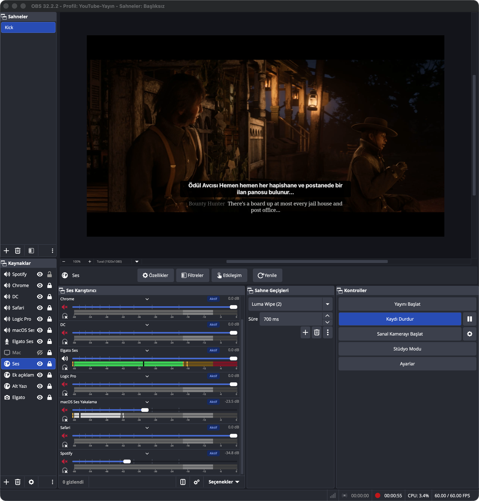
  <br>
  <sub>Gerçek bir OBS sahnesi: <b>Alt Yazı</b>, <b>Ses</b> ve <b>Ek açıklama</b> ayrı Tarayıcı kaynakları olarak Elgato görüntüsünün üstünde.</sub>
</p>

Ayarlar › OBS / Yayın › **Yazıları OBS'te ayrı yerlere koy** altındaki adresleri ayrı Tarayıcı kaynakları olarak ekle
(önerilen boyut **1920 × 300**), sonra OBS'te sürükleyip kenarlarından boyutlandır. Bu durumda tek adresli kaynağı kaldır.

| Kaynak | Adres |
|---|---|
| Altyazı | `http://127.0.0.1:8765/?only=subtitle` |
| Ses çevirisi | `http://127.0.0.1:8765/?only=speech` |
| Bildirimler / ek bölgeler | `http://127.0.0.1:8765/?only=zone` |

Adresin sonuna parametre ekleyerek kaynak başına ayrı stil verebilirsin:
`&size=32` (yazı boyutu), `&font=Arial&weight=800` (yazı tipi ve kalınlık), `&pos=top` (konum), `&box=e0245e&alpha=0.8` (kutu rengi ve koyuluğu), `&original=1` (orijinal metni de göster).

### İpuçları
- Oyunu OBS'te **Ekran Yakalama** ile alıyorsan Mac'teki çeviri yazıları zaten yayına girer. Çift görünmesin diye
  Ayarlar › Görünüm › **"Çeviriyi orijinal altyazının üzerine çiz"** seçeneğini kapat; yayında yalnızca Tarayıcı kaynağı kalır.
- OBS'te yazı görünmüyorsa: kaynağın özelliklerinde **Geçerli sayfayı yenile**'ye bas, adresin doğru olduğunu ve
  Ayarlar'da "Bağlı yayın sayfası" sayısının 0'dan büyük olduğunu kontrol et.
- **İki bilgisayarlı yayın:** Ayarlar › OBS › Gelişmiş › **Ağdaki diğer bilgisayarlar bağlanabilsin** seçeneğini aç; görünen yerel ağ
  adresini yayın bilgisayarındaki OBS'e gir.
- **Metin kaynağı tercih edenler için:** "Çeviriyi metin dosyasına da yaz" açılınca OBS **Metin (FreeType 2)** kaynağının
  "Dosyadan oku" seçeneğiyle de kullanılabilir.

## Kullanım

<details>
<summary><b>Oyun profili ayarlamak</b></summary>

**Ayarla** (⇧⌘P) penceresi oyunun canlı görüntüsünü gösterir. Bölge çipini seç, önizlemede dikdörtgen çiz (⌥ ile taşı),
yüzde adımlarıyla ince ayar yap. "Okunan metin" anında güncellenir; **Ekranda örnek göster** çeviriyi gerçek yerinde ve
boyutunda gösterir. Hazır profiller: Genel, Film/dizi, Küçük yazılı oyunlar, Tüm ekran. Kendi profillerini kaydedebilirsin.
</details>

<details>
<summary><b>Sesli konuşma çevirisi</b></summary>

Profil düzenleyicide **Ses çevirisi** alanını aç ve balonun yerini seç. "Yalnızca altyazı yokken" ya da "her zaman" çalışabilir.
Müzik ve efektler doğruluğu düşürür; en iyi sonuç diyalogların net duyulduğu sahnelerde alınır.
</details>

<details>
<summary><b>Çeviri motorları</b></summary>

| Motor | Notlar |
|---|---|
| **Apple** (varsayılan) | Tamamen çevrimdışı ve ücretsiz. Dil paketi bir kez iner. |
| DeepL / Google / Azure | Kendi API anahtarınla. |
| LLM | OpenAI uyumlu her uç nokta: OpenAI, Ollama (`http://localhost:11434/v1`), LM Studio… |
| Self-Hosted | LibreTranslate uyumlu kendi sunucun ya da yerel ağdaki bir sunucu. |

API anahtarları macOS **Anahtar Zinciri**'nde saklanır.
</details>

<details>
<summary><b>Kısayollar</b></summary>

| Kısayol | İşlev |
|---|---|
| ⌃⌥T | Çeviriyi başlat / durdur (oyun öndeyken de) |
| ⌃⌥H | Çeviri yazılarını gizle / göster (oyun öndeyken de) |
| ⌃⌥Y | Çevirileri yalnızca OBS yayınında gizle / göster |
| ⌘R | Başlat / durdur |
| ⌘K | Kaynak seç |
| ⇧⌘P | Oyun profilini ayarla |
| ⌘, | Ayarlar |
</details>

## Uygulamada bir tur

<sub>Ekran görüntüleri macOS sürümünden alınmıştır. Windows sürümü aynı bölümleri ve ayarları sunar; kısayollarda ⌃⌥ yerine Ctrl+Alt kullanılır.</sub>

<table>
<tr>
<td width="42%"></td>
<td>

### Ana pencere
- **Başlık:** OBS yayın durumu ve çeviri motorunun türü (ör. **Çevrimdışı**).
- **Tema** (açık / koyu / sistem), **Ayarlar** ve son çevirinin süresi.
- **Yakalama kaynağı:** çevrilecek pencere (ör. *Pencere: Elgato Studio*), **Değiştir** ile seçilir.
- **Oyun profili** seçimi; **Ayarla** okuma bölgelerini ve görüntü işlemeyi açar.
- **Canlı çeviri:** okunan orijinal metin ve altında çevirisi; durum (ör. *Durduruldu*).
- **Oyun dili → çeviri dili** ve hızlı motor seçimi: Apple, DeepL, Azure, Google, LLM, Self-Hosted.
- **Çeviri motoru** kartı: seçili motor ve durumu (**AKTİF** / **AYAR GEREKLİ**).
- **Sesli konuşma çevirisi** anahtarı.
- Yeni sürüm çıktığında **Ayrıntılar** düğmeli bilgi şeridi.

</td>
</tr>
<tr>
<td colspan="2"></td>
</tr>
<tr>
<td colspan="2">

### Oyun profili
- **Bölgeler:** Altyazı, Bölge 1–3 ve Ses çevirisi; her biri kendi rengiyle canlı görüntü üzerinde. Seçili bölgenin adı sağ üstten değiştirilir.
- **Çizim:** seçili bölge için sürükleyerek yeni dikdörtgen çizilir, ⌥ (Option) basılıyken sürüklenince bölge taşınır.
- **İnce ayar:** Sol, Üst, Genişlik ve Yükseklik yüzde olarak adım adım ayarlanır.
- **Yazı boyutu:** bölge başına otomatik ya da elle; **Ekranda örnek göster** çevirinin oyunda nasıl duracağını gösterir.
- **Okunan metin:** her bölgede okunan yazı ve ses seviyesiyle birlikte son duyulan konuşma.
- **Seçilen bölge / OCR'a giden:** ham görüntü ve okumaya giden işlenmiş görüntü yan yana.
- **Okuma ayarları** (tüm bölgeler için): büyütme (1×–3×), siyah-beyaz eşikleme, kontrast, güven eşiği, hassas OCR ve kararlılık.
- Yerleşik profil düzenlenince **kopya olarak kaydedilir**; **Sıfırla** değişiklikleri geri alır.

</td>
</tr>
<tr>
<td width="42%">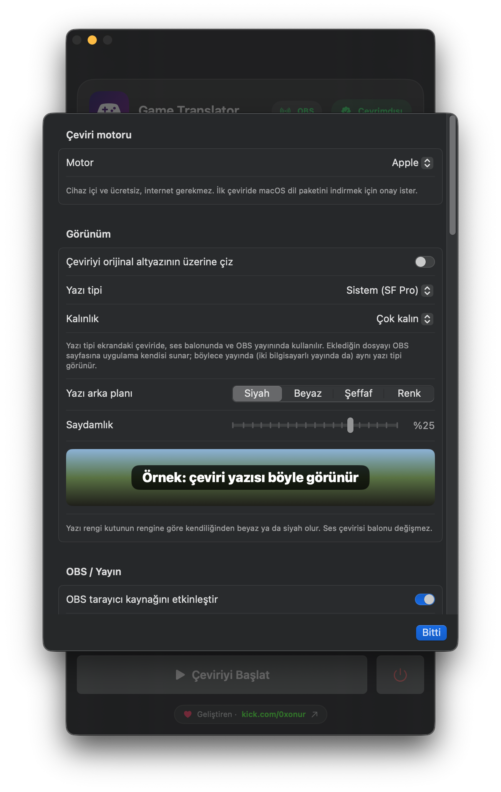</td>
<td>

### Çeviri motoru ve görünüm
- **Motor** seçimi ve kısa açıklaması (ör. Apple: cihaz içi ve ücretsiz, internet gerekmez).
- **Çeviriyi orijinal altyazının üzerine çiz:** ekrandaki çeviri katmanını açıp kapatır.
- **Yazı tipi** ve **Kalınlık** (Normal'den Çok kalın'a).
- **Yazı arka planı:** Siyah, Beyaz, Şeffaf ya da Renk; **Saydamlık** kaydırıcısı.
- Örnek zemin üzerinde **canlı önizleme**. Yazı rengi kutunun rengine göre kendiliğinden beyaz ya da siyah olur.

</td>
</tr>
<tr>
<td width="42%">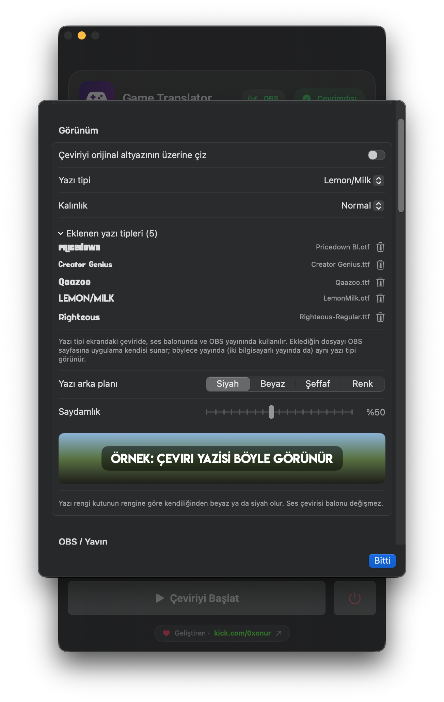</td>
<td>

### Yazı tipleri
- **Yazı tipi:** hazır seçenekler, bilgisayarda yüklü yazı tipleri ya da kendi eklediğin bir yazı tipi seçilir.
- **Kendi yazı tipini ekle:** .ttf ya da .otf dosyası eklenebilir. Dosya yalnızca uygulamaya eklenir, sisteme kurulmaz.
- **Eklenen yazı tipleri** listesinde her yazı tipi kendi görünümüyle ve dosya adıyla görünür; çöp kutusu simgesiyle tek tıkla kaldırılır.
- **Kalınlık** ayrıca seçilir.
- Seçilen yazı tipi **canlı önizlemede** hemen görünür; ekrandaki çeviride, ses balonunda ve **OBS yayınında** aynı anda kullanılır.
  Eklenen dosyayı uygulama yayın sayfasına kendisi sunar; iki bilgisayarlı yayında da aynı yazı tipi görünür.

</td>
</tr>
<tr>
<td width="42%">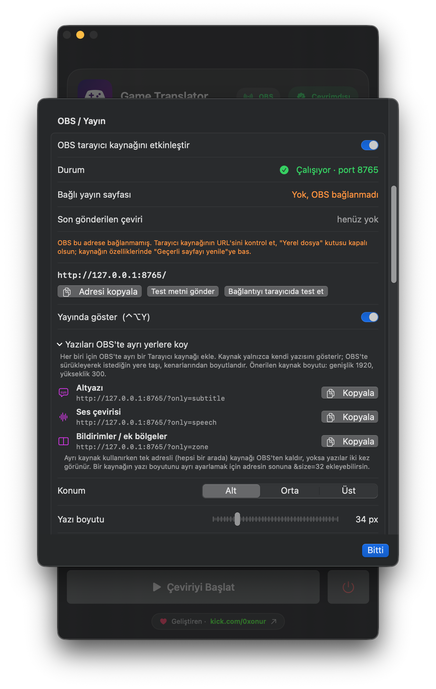</td>
<td>

### OBS / Yayın
- **OBS tarayıcı kaynağını etkinleştir** ve sunucu **durumu** (ör. *Çalışıyor · port 8765*).
- **Bağlı yayın sayfası** ve **son gönderilen çeviri**; OBS bağlanmamışsa ne yapılacağı yazılır.
- Yayın adresi; **Adresi kopyala**, **Test metni gönder**, **Bağlantıyı tarayıcıda test et**.
- **Yayında göster (⌃⌥Y):** çevirileri yalnızca yayında gizle / göster.
- **Yazıları OBS'te ayrı yerlere koy:** Altyazı, Ses çevirisi ve Bildirimler / ek bölgeler için ayrı adresler, her biri tek tıkla kopyalanır.

</td>
</tr>
<tr>
<td width="42%">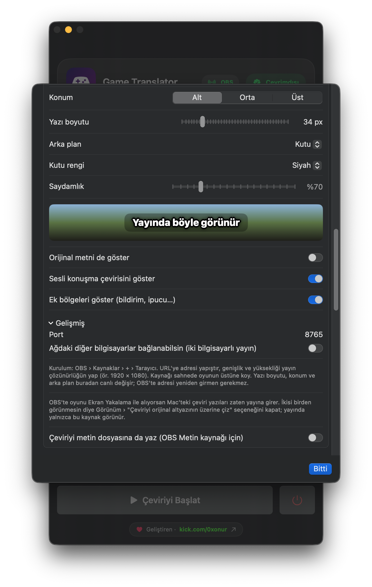</td>
<td>

### Yayın görünümü
- **Konum** (Alt / Orta / Üst) ve **Yazı boyutu** (px).
- **Arka plan** (ör. Kutu), **Kutu rengi** ve **Saydamlık**; "Yayında böyle görünür" önizlemesi.
- **Orijinal metni de göster**, **Sesli konuşma çevirisini göster**, **Ek bölgeleri göster**.
- **Gelişmiş:** port ve ağdaki diğer bilgisayarların bağlanması (iki bilgisayarlı yayın).
- **Çeviriyi metin dosyasına da yaz:** OBS Metin kaynağı için.

</td>
</tr>
<tr>
<td width="42%">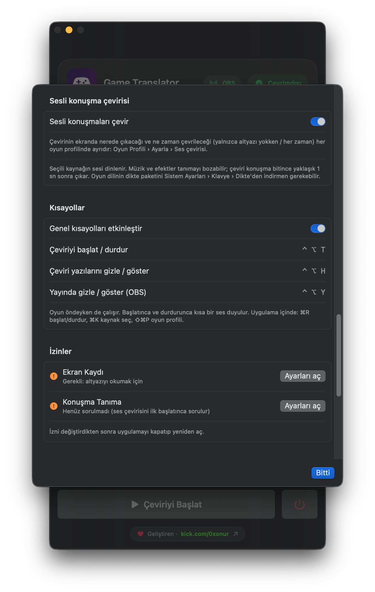</td>
<td>

### Ses çevirisi, kısayollar ve izinler
- **Sesli konuşmaları çevir:** çevirinin yeri ve zamanı her oyun profilinde ayrı ayarlanır.
- **Genel kısayollar:** ⌃⌥T çeviriyi başlat / durdur, ⌃⌥H çeviri yazılarını gizle / göster, ⌃⌥Y yayında gizle / göster. Uygulama içinde ⌘R, ⌘K ve ⇧⌘P.
- **İzinler:** Ekran Kaydı ve Konuşma Tanıma durumu; eksik izinde **Ayarları aç** ilgili sistem ayarına götürür.

</td>
</tr>
<tr>
<td width="42%">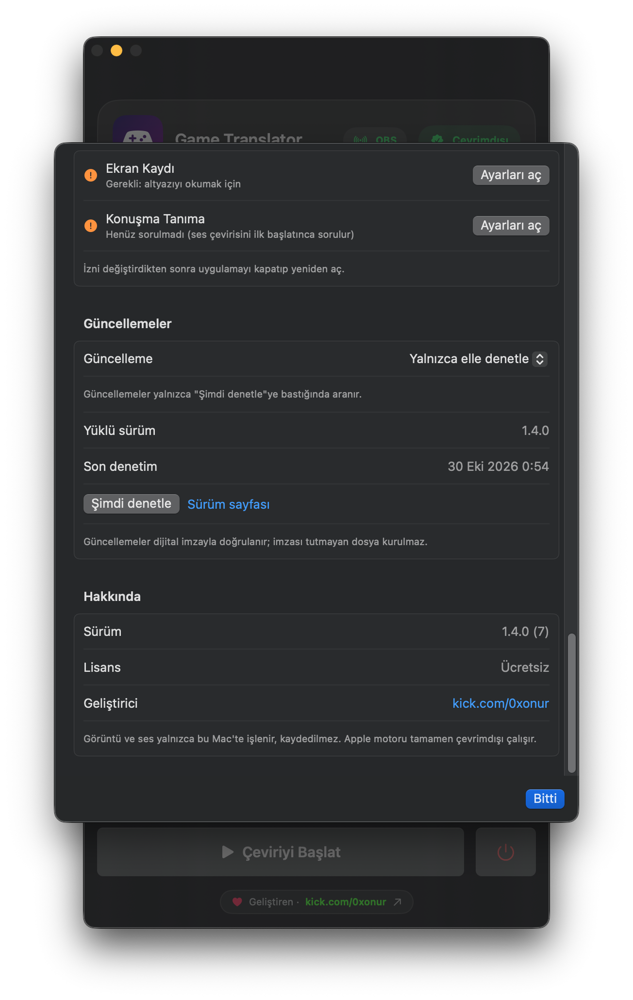</td>
<td>

### Güncellemeler ve hakkında
- **Güncelleme** tercihi: yalnızca elle denetle, otomatik denetle ve haber ver ya da otomatik indir ve kur.
- **Yüklü sürüm**, **son denetim** zamanı, **Şimdi denetle** ve **Sürüm sayfası**.
- Güncellemeler dijital imzayla doğrulanır; imzası tutmayan dosya kurulmaz.
- **Hakkında:** sürüm, lisans ve geliştirici bağlantısı.

</td>
</tr>
<tr>
<td width="42%">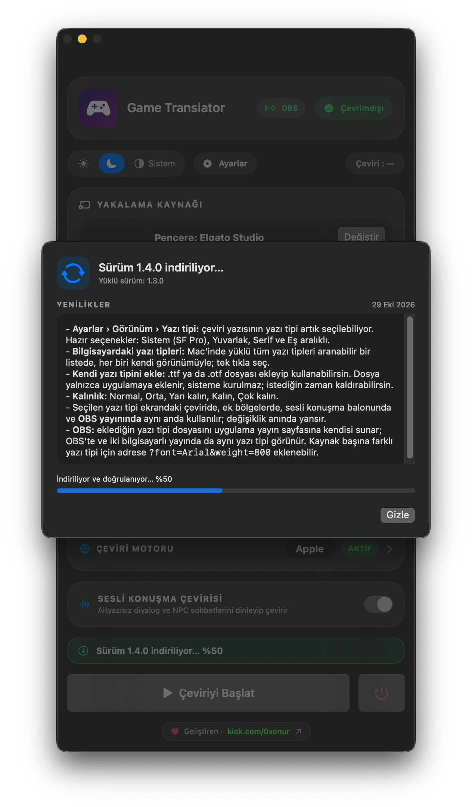</td>
<td>

### Uygulama içi güncelleme
- Yeni sürüm bulunduğunda **yenilikler** listesiyle birlikte gösterilir.
- Dosya **indirilir ve doğrulanır**; ilerleme hem pencerede hem ana penceredeki şeritte görünür.
- **Gizle** ile pencere kapatılır, indirme arka planda sürer.

</td>
</tr>
</table>

## Güncellemeler

Uygulama yeni sürümleri kendisi denetler. **Ayarlar › Güncellemeler**'den seç: yalnızca elle denetle, otomatik denetle ve haber ver
(varsayılan) ya da otomatik indir ve kur. Her güncelleme Ed25519 dijital imzasıyla doğrulanır; imzası tutmayan dosya kurulmaz,
kurulum başarısız olursa eski sürüm geri konur. Güncellemeden sonra macOS Ekran Kaydı iznini yeniden isteyebilir.

İndirdiğin dosyanın bozulmadığını elle doğrulamak istersen, sürüm sayfasındaki `.sha256` değeriyle karşılaştır:
```bash
shasum -a 256 ~/Downloads/GameTranslator-*-macOS.zip
```
Windows'ta (PowerShell):
```powershell
Get-FileHash $HOME\Downloads\GameTranslator-*-Windows.zip -Algorithm SHA256
```

## Sık sorulanlar

<details>
<summary><b>"Uygulama açılamıyor, geliştirici doğrulanamadı" diyor</b></summary>

Uygulamaya **sağ tıkla › Aç › Aç**. Olmazsa Sistem Ayarları › Gizlilik ve Güvenlik › aşağıda **Yine de Aç**. Bu yalnızca ilk açılışta gerekir.
</details>

<details>
<summary><b>Windows "Bilgisayarınız korundu" diyor</b></summary>

SmartScreen uyarısında **Ek bilgi › Yine de çalıştır**'a bas. Uygulama kod imzası taşımadığı için Windows bunu yalnızca ilk açılışta sorar.
</details>

<details>
<summary><b>Windows'ta çeviri oyunun üstünde görünmüyor</b></summary>

Oyunu **pencere** ya da **tam ekran pencere (borderless)** modunda çalıştır. Özel tam ekran (exclusive fullscreen) modunda Windows hiçbir
uygulamanın oyunun üstüne çizmesine izin vermez. Görüntü siyahsa oyunu öne getir ya da **Ekran** kaynağını seç.
</details>

<details>
<summary><b>Pencere listesi boş ya da görüntü siyah (macOS)</b></summary>

Ekran Kaydı izni eksiktir: Sistem Ayarları › Gizlilik ve Güvenlik › Ekran ve Sistem Ses Kaydı › Game Translator'ı aç ve uygulamayı
yeniden başlat. Güncellemeden sonra izni kapatıp açman gerekebilir. Bazı korumalı uygulamalar yakalamada siyah görüntü verir;
o durumda **Ekran** kaynağını dene.
</details>

<details>
<summary><b>Yazılar okunmuyor ya da yanlış okunuyor</b></summary>

**Ayarla** penceresinde bölgeyi yalnızca altyazıyı kapsayacak şekilde daralt, "Küçük yazılı oyunlar" profilini dene, görüntü
büyütmeyi artır. Oyun dilinin doğru seçildiğinden emin ol.
</details>

<details>
<summary><b>İnternet gerekiyor mu?</b></summary>

macOS'ta Apple motoruyla hayır: dil paketi bir kez indikten sonra tamamen çevrimdışı çalışır. Windows'ta ve her iki sistemde Ollama / LM Studio ile
yerel model kullanırsan da internet gerekmez. Oyuna bir [dil paketi](#dil-paketleri) bağlarsan, paketteki yazılar
hangi motor seçili olursa olsun internetsiz çevrilir. DeepL, Google, Azure ve bulut LLM'ler internet ister.
</details>

<details>
<summary><b>Ücretli mi? Kaynak kodu var mı?</b></summary>

Uygulama tamamen ücretsizdir. Kaynak kodu paylaşılmaz; bu depo yalnızca indirme, sürüm notları ve destek içindir.
</details>

## Gizlilik

Ekran görüntüsü ve ses yalnızca senin bilgisayarında, bellekte işlenir; kaydedilmez, hiçbir yere gönderilmez. Apple motoru internet kullanmaz.
Bulut motoru seçersen yalnızca okunan metin, kendi API anahtarınla o sağlayıcıya gönderilir. Uygulama güncelleme denetimi için
yalnızca bu deponun herkese açık sürüm bilgisini okur; kullanıcı verisi toplamaz.

## Destek ve geri bildirim

- **Hata bildirimi ve öneriler:** [Issues](https://github.com/0xxnr/GameTranslator/issues/new/choose)
- **Güvenlik açığı:** [SECURITY.md](SECURITY.md)

## Lisans

Ücretsiz kullanım; değiştirme, tersine mühendislik ve yeniden dağıtım yasaktır. Ayrıntılar: [LICENSE](LICENSE).
Uygulamada ve bu sayfada adı geçen oyun ve platform adları ilgili sahiplerinin ticari markalarıdır; bu projenin onlarla bağlantısı yoktur.

<p align="center"><sub>© 2026 · Game Translator</sub></p>
