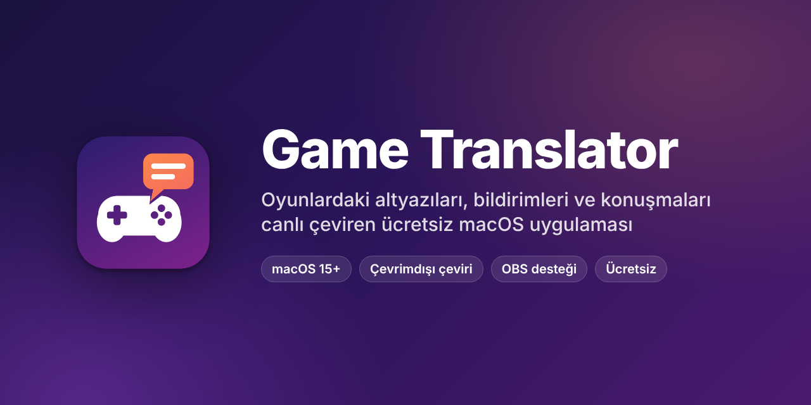
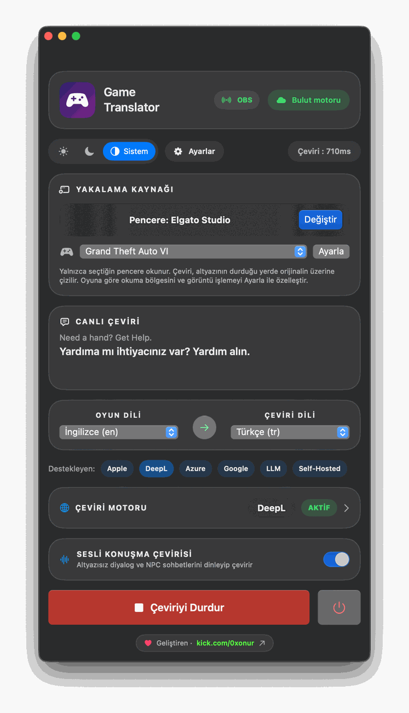
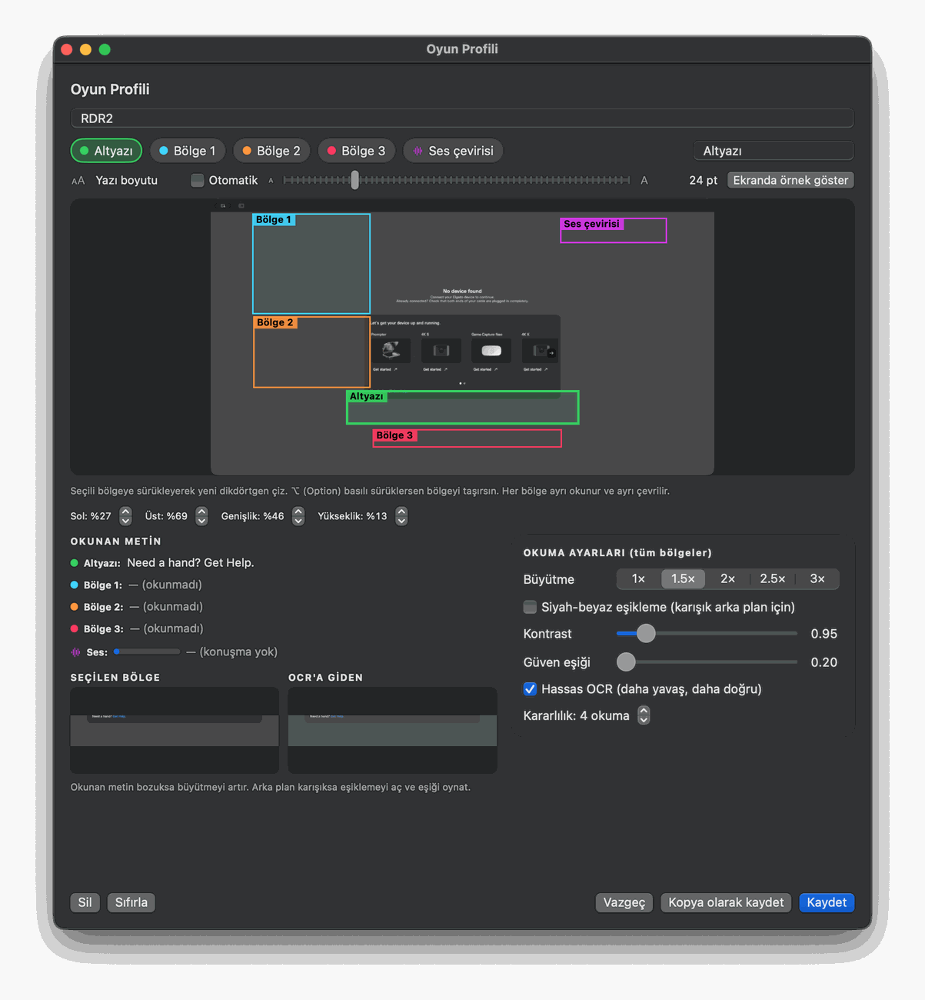
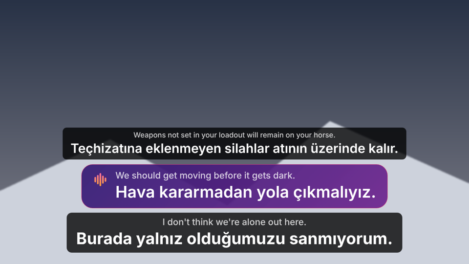
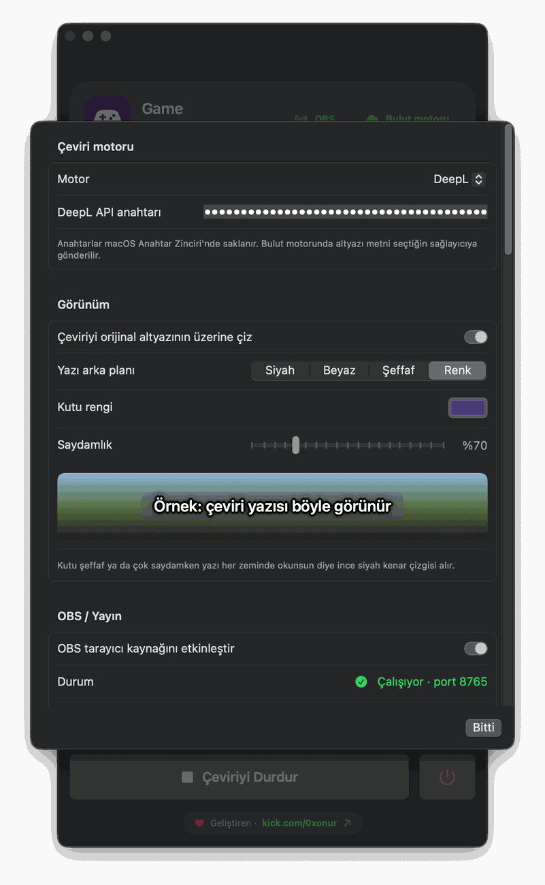
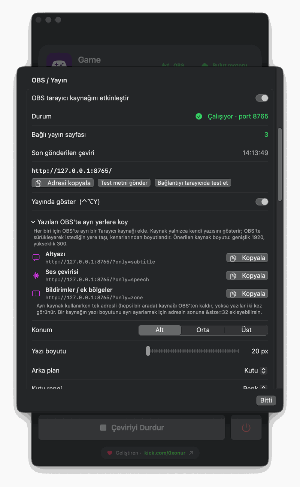
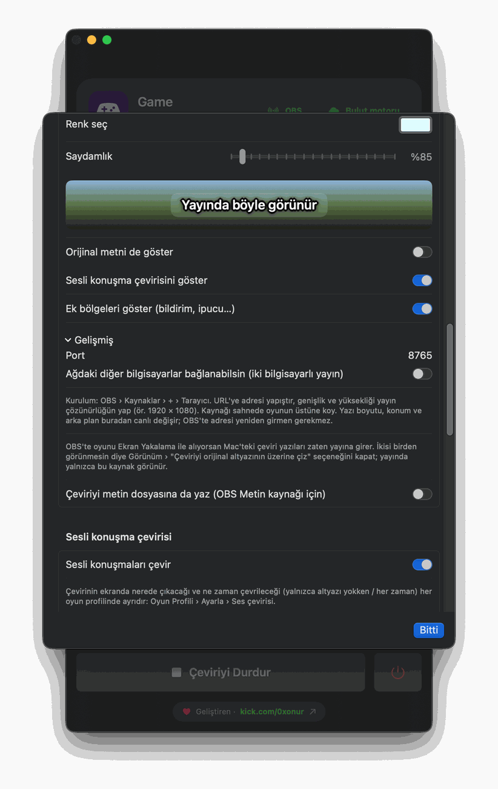
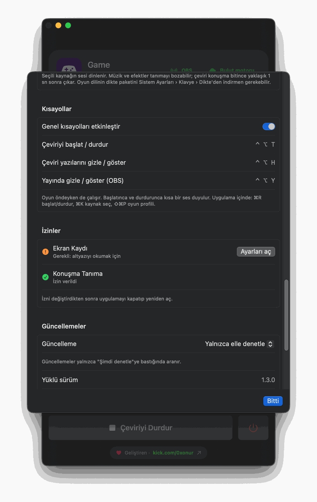

<p align="center">
  
</p>

<p align="center">
  <a href="https://github.com/0xxnr/GameTranslator/releases/latest"></a>
  <a href="https://github.com/0xxnr/GameTranslator/releases"></a>
  
  
  
</p>

<p align="center">
  <a href="https://github.com/0xxnr/GameTranslator/releases/latest"><b>⬇&nbsp; Son sürümü indir</b></a>
  &nbsp;·&nbsp; <a href="#kurulum">Kurulum</a>
  &nbsp;·&nbsp; <a href="#özellikler">Özellikler</a>
  &nbsp;·&nbsp; <a href="#sık-sorulanlar">Sık sorulanlar</a>
  &nbsp;·&nbsp; <a href="CHANGELOG.md">Sürüm notları</a>
</p>

---

**Game Translator**, oyun ekranındaki yazıyı okur, çevirir ve çeviriyi **orijinal yazının tam üstüne** çizer. Altyazı değiştikçe
ve pencere taşındıkça takip eder. Altyazısı olmayan diyalogları dinleyip çevirebilir, çevirileri **OBS** ile yayına da gönderebilir.
PS Remote Play, Elgato, GeForce NOW, Steam Link, tarayıcı ve video oynatıcılarla çalışır.

<p align="center">
  
  &nbsp;&nbsp;
  
</p>

## Özellikler

| | |
|---|---|
| 🎯 **Yerinde çeviri** | Çeviri, orijinal altyazının üstünde aynı yerde görünür; tıklamalar oyuna geçer. Ana pencerede orijinal ve çeviri yan yana, çeviri süresi (ms) üstte görünür. |
| 🎮 **Oyun profilleri** | Altyazı + en fazla 3 ek bölge (bildirim, görev, ipucu) + ses çevirisi alanı. Her bölgenin yazı boyutu ayrı ya da otomatik. |
| 🔬 **Okuma ayarları** | Büyütme (1×–3×), siyah-beyaz eşikleme, kontrast, güven eşiği, hassas OCR ve kararlılık. "OCR'a giden" görüntüyü canlı izlersin. |
| 🗣️ **Sesli konuşma çevirisi** | Altyazısız diyalogları ve NPC sohbetlerini dinler, mor bir balonda çevirir. Konuşma tanıma cihazda çalışır. |
| 🎨 **Yazı arka planı** | Siyah, beyaz, şeffaf ya da istediğin renk; saydamlık ayarı ve canlı önizleme. Yazı rengi kendiliğinden uyum sağlar. |
| 📺 **OBS ile yayın** | Çeviriler yayına şeffaf arka planla düşer. Altyazı, ses ve bildirimler ayrı kaynaklar olarak ayrı yerlere konabilir; kutu rengi yayında ayrı seçilir. |
| 🌐 **Çeviri motorları** | Apple (çevrimdışı, ücretsiz), DeepL, Google, Azure, LLM (OpenAI, Ollama, LM Studio), Self-Hosted (LibreTranslate). |
| ⌨️ **Genel kısayollar** | Oyun öndeyken de çalışır: ⌃⌥T başlat/durdur, ⌃⌥H yazıları gizle, ⌃⌥Y yalnızca yayında gizle. |
| 🔄 **Otomatik güncelleme** | Yeni sürümü kendisi bulur; her güncelleme dijital imzayla doğrulanır. |
| 🔒 **Gizlilik** | Ekran ve ses yalnızca senin Mac'inde, bellekte işlenir; kaydedilmez, gönderilmez. |

## Kurulum

1. **[Sürümler](https://github.com/0xxnr/GameTranslator/releases/latest)** sayfasından `GameTranslator-x.y.z-macOS.zip` dosyasını indir ve aç.
2. **Game Translator.app**'i **Uygulamalar** klasörüne sürükle.
3. İlk açılışta uygulamaya **sağ tıkla › Aç › Aç**. *(Uygulama Apple noter onaylı olmadığı için macOS bir kez sorar.)*
   Uyarı geçmezse: **Sistem Ayarları › Gizlilik ve Güvenlik** › aşağıda **Yine de Aç**.
4. **Değiştir** ile oyun penceresini seç. İstenince **Ekran Kaydı** iznini ver:
   Sistem Ayarları › Gizlilik ve Güvenlik › **Ekran ve Sistem Ses Kaydı** › Game Translator'ı aç, uygulamayı yeniden başlat.
5. Oyun dilini ve çeviri dilini seç, ardından **Çeviriyi Başlat** (⌘R) ya da oyundayken **⌃⌥T**.

**Gereksinimler:** macOS 15 (Sequoia) veya üstü, Apple silicon (M1 ve üstü) işlemcili Mac. Sesli konuşma çevirisi için oyun dilinin dikte paketi
(Sistem Ayarları › Klavye › Dikte) gerekebilir.

## Kullanım

<details>
<summary><b>Oyun profili ayarlamak</b></summary>

**Ayarla** (⇧⌘P) penceresi oyunun canlı görüntüsünü gösterir. Bölge çipini seç, önizlemede dikdörtgen çiz (⌥ ile taşı),
yüzde adımlarıyla ince ayar yap. "Okunan metin" anında güncellenir; **Ekranda örnek göster** çeviriyi gerçek yerinde ve
boyutunda gösterir. Hazır profiller: Genel, Film/dizi, Küçük yazılı oyunlar, Tüm ekran. Kendi profillerini kaydedebilirsin.
</details>

<details>
<summary><b>Sesli konuşma çevirisi</b></summary>

Profil düzenleyicide **Ses çevirisi** alanını aç ve balonun yerini seç. "Yalnızca altyazı yokken" ya da "her zaman" çalışabilir.
Müzik ve efektler doğruluğu düşürür; en iyi sonuç diyalogların net duyulduğu sahnelerde alınır.
</details>

<details>
<summary><b>OBS ile yayın</b></summary>

<p align="center"></p>

1. **Ayarlar › OBS / Yayın › OBS tarayıcı kaynağını etkinleştir.** Adres görünür: `http://127.0.0.1:8765/`
2. OBS › Kaynaklar › **+** › **Tarayıcı**. URL'ye adresi yapıştır; genişlik/yükseklik yayın çözünürlüğün (ör. 1920 × 1080).
3. Kaynağı sahnede oyunun üstüne koy. **Test metni gönder** ile konumu ve boyutu kontrol et.

Yazı boyutu, konum, kutu rengi ve saydamlığı uygulamadan canlı değişir. Altyazı, ses çevirisi ve bildirimleri ayrı yerlere
koymak için Ayarlar'daki üç ayrı adresi (`?only=subtitle`, `?only=speech`, `?only=zone`) ayrı Tarayıcı kaynakları olarak ekle.
Oyunu OBS'te **Ekran Yakalama** ile alıyorsan, çift görünmesin diye Görünüm › "Çeviriyi orijinal altyazının üzerine çiz"i kapat.
</details>

<details>
<summary><b>Çeviri motorları</b></summary>

| Motor | Notlar |
|---|---|
| **Apple** (varsayılan) | Tamamen çevrimdışı ve ücretsiz. Dil paketi bir kez iner. |
| DeepL / Google / Azure | Kendi API anahtarınla. |
| LLM | OpenAI uyumlu her uç nokta: OpenAI, Ollama (`http://localhost:11434/v1`), LM Studio… |
| Self-Hosted | LibreTranslate uyumlu kendi sunucun ya da yerel ağdaki bir sunucu. |

API anahtarları macOS **Anahtar Zinciri**'nde saklanır.
</details>

<details>
<summary><b>Kısayollar</b></summary>

| Kısayol | İşlev |
|---|---|
| ⌃⌥T | Çeviriyi başlat / durdur (oyun öndeyken de) |
| ⌃⌥H | Çeviri yazılarını gizle / göster (oyun öndeyken de) |
| ⌃⌥Y | Çevirileri yalnızca OBS yayınında gizle / göster |
| ⌘R | Başlat / durdur |
| ⌘K | Kaynak seç |
| ⇧⌘P | Oyun profilini ayarla |
| ⌘, | Ayarlar |
</details>

## Uygulamada bir tur

<table>
<tr>
<td width="42%"></td>
<td>

### Ana pencere
- **Yakalama kaynağı:** çevrilecek pencere (ör. Elgato Studio, PS Remote Play). **Değiştir** ile seçilir.
- **Oyun profili** seçimi ve **Ayarla** ile okuma bölgeleri.
- **Canlı çeviri:** okunan orijinal metin ve altında çevirisi.
- **Oyun dili → çeviri dili** ve kullanılan **çeviri motoru** (AKTİF / AYAR GEREKLİ).
- **Sesli konuşma çevirisi** anahtarı.
- Üstte **OBS** ve **Bulut motoru** durumu, çeviri süresi; açık / koyu / sistem teması.

</td>
</tr>
<tr>
<td colspan="2"></td>
</tr>
<tr>
<td colspan="2">

### Oyun profili
Oyunun canlı görüntüsü üzerinde **Altyazı**, **Bölge 1–3** ve **Ses çevirisi** alanlarını çizersin; her bölge ayrı okunur ve ayrı çevrilir.
Yüzde değerleriyle (Sol, Üst, Genişlik, Yükseklik) ince ayar yapılır, **Ekranda örnek göster** çevirinin oyunda nasıl duracağını gösterir.
**Okunan metin** her bölgede neyin okunduğunu, **Seçilen bölge / OCR'a giden** önizlemeleri görüntünün nasıl işlendiğini gösterir.
Okuma bozuksa büyütmeyi artır; arka plan karışıksa siyah-beyaz eşiklemeyi aç.

</td>
</tr>
<tr>
<td width="42%"></td>
<td>

### Çeviri motoru ve görünüm
- Motor seçimi ve API anahtarı (macOS Anahtar Zinciri'nde saklanır).
- **Yazı arka planı:** Siyah, Beyaz, Şeffaf ya da Renk; **Kutu rengi** ve **Saydamlık**.
- Örnek zemin üzerinde canlı önizleme. Kutu şeffaf ya da çok saydamken yazı ince siyah kenar çizgisi alır.

</td>
</tr>
<tr>
<td width="42%"></td>
<td>

### OBS / Yayın
- Sunucu durumu, **bağlı yayın sayfası** sayısı ve **son gönderilen çeviri** saati.
- **Adresi kopyala**, **Test metni gönder**, **Bağlantıyı tarayıcıda test et**.
- **Yayında göster (⌃⌥Y):** çevirileri yalnızca yayında gizle / göster.
- **Yazıları OBS'te ayrı yerlere koy:** Altyazı, Ses çevirisi ve Bildirimler için ayrı adresler, tek tıkla kopyala.
- Konum (alt / orta / üst) ve yazı boyutu.

</td>
</tr>
<tr>
<td width="42%"></td>
<td>

### Yayın görünümü
- Yayındaki kutunun **rengi** ve **saydamlığı**, "Yayında böyle görünür" önizlemesi.
- Orijinal metni, sesli konuşma çevirisini ve ek bölgeleri yayında göster / gizle.
- **Gelişmiş:** port ve iki bilgisayarlı yayın için ağ erişimi.
- Çeviriyi metin dosyasına da yaz (OBS Metin kaynağı için).

</td>
</tr>
<tr>
<td width="42%"></td>
<td>

### Kısayollar, izinler, güncellemeler
- Genel kısayollar: ⌃⌥T, ⌃⌥H, ⌃⌥Y.
- **İzinler:** Ekran Kaydı ve Konuşma Tanıma durumu; eksik izin turuncu görünür, **Ayarları aç** ilgili sayfaya götürür.
- **Güncellemeler:** yalnızca elle / otomatik denetle / otomatik indir ve kur, yüklü sürüm.

</td>
</tr>
</table>

## Güncellemeler

Uygulama yeni sürümleri kendisi denetler. **Ayarlar › Güncellemeler**'den seç: yalnızca elle denetle, otomatik denetle ve haber ver
(varsayılan) ya da otomatik indir ve kur. Her güncelleme Ed25519 dijital imzasıyla doğrulanır; imzası tutmayan dosya kurulmaz,
kurulum başarısız olursa eski sürüm geri konur. Güncellemeden sonra macOS Ekran Kaydı iznini yeniden isteyebilir.

İndirdiğin dosyanın bozulmadığını elle doğrulamak istersen, sürüm sayfasındaki `.sha256` değeriyle karşılaştır:
```bash
shasum -a 256 ~/Downloads/GameTranslator-*-macOS.zip
```

## Sık sorulanlar

<details>
<summary><b>"Uygulama açılamıyor, geliştirici doğrulanamadı" diyor</b></summary>

Uygulamaya **sağ tıkla › Aç › Aç**. Olmazsa Sistem Ayarları › Gizlilik ve Güvenlik › aşağıda **Yine de Aç**. Bu yalnızca ilk açılışta gerekir.
</details>

<details>
<summary><b>Pencere listesi boş ya da görüntü siyah</b></summary>

Ekran Kaydı izni eksiktir: Sistem Ayarları › Gizlilik ve Güvenlik › Ekran ve Sistem Ses Kaydı › Game Translator'ı aç ve uygulamayı
yeniden başlat. Güncellemeden sonra izni kapatıp açman gerekebilir. Bazı korumalı uygulamalar yakalamada siyah görüntü verir;
o durumda **Ekran** kaynağını dene.
</details>

<details>
<summary><b>Yazılar okunmuyor ya da yanlış okunuyor</b></summary>

**Ayarla** penceresinde bölgeyi yalnızca altyazıyı kapsayacak şekilde daralt, "Küçük yazılı oyunlar" profilini dene, görüntü
büyütmeyi artır. Oyun dilinin doğru seçildiğinden emin ol.
</details>

<details>
<summary><b>İnternet gerekiyor mu?</b></summary>

Apple motoruyla hayır: dil paketi bir kez indikten sonra tamamen çevrimdışı çalışır. DeepL, Google, Azure ve bulut LLM'ler internet ister.
</details>

<details>
<summary><b>Ücretli mi? Kaynak kodu var mı?</b></summary>

Uygulama tamamen ücretsizdir. Kaynak kodu paylaşılmaz; bu depo yalnızca indirme, sürüm notları ve destek içindir.
</details>

## Gizlilik

Ekran görüntüsü ve ses yalnızca bu Mac'te, bellekte işlenir; kaydedilmez, hiçbir yere gönderilmez. Apple motoru internet kullanmaz.
Bulut motoru seçersen yalnızca okunan metin, kendi API anahtarınla o sağlayıcıya gönderilir. Uygulama güncelleme denetimi için
yalnızca bu deponun herkese açık sürüm bilgisini okur; kullanıcı verisi toplamaz.

## Destek ve geri bildirim

- **Hata bildirimi ve öneriler:** [Issues](https://github.com/0xxnr/GameTranslator/issues/new/choose)
- **Güvenlik açığı:** [SECURITY.md](SECURITY.md)

## Lisans

Ücretsiz kullanım; değiştirme, tersine mühendislik ve yeniden dağıtım yasaktır. Ayrıntılar: [LICENSE](LICENSE).
Uygulamada ve bu sayfada adı geçen oyun ve platform adları ilgili sahiplerinin ticari markalarıdır; bu projenin onlarla bağlantısı yoktur.

<p align="center"><sub>© 2026 · Game Translator</sub></p>
